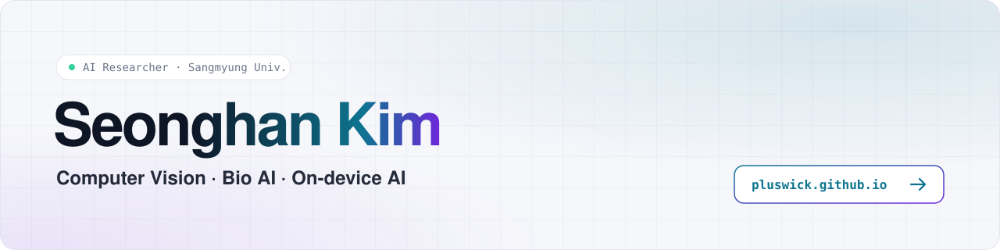
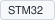

<a href="https://pluswick.github.io">
  <picture>
    <source media="(prefers-color-scheme: dark)" srcset="./assets/banner-dark.svg">
    
  </picture>
</a>

  <a href="https://pluswick.github.io">Portfolio</a> ·
  <a href="https://pluswick.github.io/cv.pdf">CV</a> ·
  <a href="mailto:lucidus814@gmail.com">Email</a>

## About

I am a final-year undergraduate at Sangmyung University, double-majoring in Electronic Engineering and Human-Centered AI Engineering.
My research focuses on machine learning for computer vision, the bio domain, and on-device inference.

For my master's degree, I aim to study model compression and optimization, how training data affects model performance, and reinforcement learning.

## Publications

- **[1st author]** Dissecting Tissue-Context Effects in Graph Neural Networks for Rat Kp Prediction: Additive Shifts, Fusion Position, and Extrapolation — *Journal of Pharmacokinetics and Pharmacodynamics* (SCIE, Q2), under review
- **[1st author]** [The choice of species representation in multi-species aquatic acute-toxicity prediction is constrained by data availability rather than by predictive accuracy](https://www.researchsquare.com/article/rs-10915713/v1) — *Journal of Cheminformatics* (SCIE, Q1), under review
- [Co-author] Implementation and Processing-Time Analysis of an NPU-Based Real-Time Iris Recognition System — *IEIE Summer Conference 2025*

## Selected Projects

| Project | Description |
|---|---|
| **Bifusion** | Normal/Anomaly classifier trainer with diffusion-based augmentation (Medfusion) and few-shot learning (ProtoNet) |
| **Mouse Filler Volume Prediction** | 3D reconstruction from 2D video with Instant-NGP — Gachon Univ. |
| **Tissue-specific Kp Prediction** | Chemprop-based GNN, lead researcher — KRIBB |
| **NPU Algorithm for Toxicity Prediction** | MLP built only from NPU-supported operators on Kneron KL630 — KRIBB |
| **DoorBox** | Face analysis on an NPU: YOLOv5s detection, EfficientNet-B0 emotion classifier, and MobileNetV3-Small gender/age models compressed by knowledge distillation |

See all projects on [my portfolio](https://pluswick.github.io/#projects).

## Languages & Tools

**Languages** 

**ML & Data** 

**Computer Vision & Generative Models** 

**Deployment & Hardware** 

**OS & Tools** 

## Problem Solving

